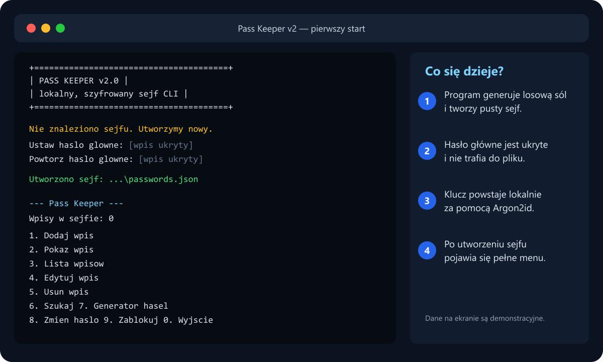
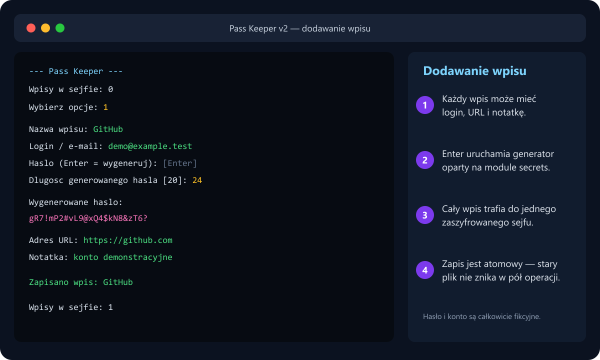
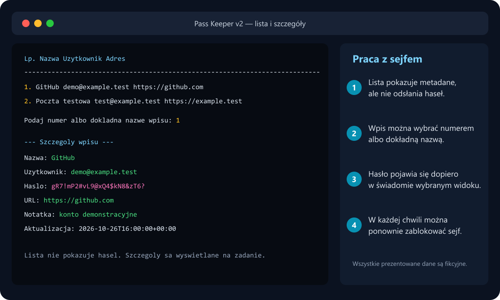

# Pass Keeper v2 🔐

Terminalowy menedżer haseł napisany w Pythonie. Projekt pozostaje prosty w
uruchomieniu, ale wersja 2 rozbudowuje edukacyjny prototyp o kompletny cykl
pracy z lokalnym, szyfrowanym sejfem.

## Co zmieniła wersja 2

- sejf jest odblokowywany hasłem głównym przy starcie,
- cały dokument — również nazwy kont i notatki — jest zaszyfrowany,
- można dodawać, wyświetlać, edytować, wyszukiwać i usuwać wpisy,
- wpis może zawierać nazwę, login/e-mail, hasło, URL i notatkę,
- generator silnych haseł korzysta z kryptograficznego modułu `secrets`,
- hasło główne można zmienić, ponownie szyfrując cały sejf,
- sejf można ręcznie zablokować bez zamykania programu,
- atomowy zapis pliku ogranicza ryzyko utraty danych,
- stary plik z pierwszej wersji jest automatycznie migrowany z kopią zapasową,
- testy regresji obejmują szyfrowanie, CRUD, migrację i zgodność formatu.

## Jak chronione są dane

Hasło główne jest przekształcane w klucz przy pomocy pamięcioodpornego
Argon2id — 19 MiB pamięci, 2 przebiegi i 1 wątek — oraz losowej 16-bajtowej
soli. Dla zgodności program nadal odczytuje sejfy v2 utworzone z
PBKDF2-HMAC-SHA256 oraz migruje format v1.

Cały dokument zawierający wpisy jest szyfrowany i uwierzytelniany przez
Fernet. W jawnym pliku pozostają tylko:

- numer wersji formatu,
- nazwa i parametry funkcji wyprowadzania klucza,
- losowa sól,
- zaszyfrowany token sejfu.

Hasło główne nie jest zapisywane. Jego utrata oznacza brak możliwości
odzyskania danych.

## Zrzuty działania

### 1. Utworzenie sejfu

Program prosi dwukrotnie o hasło główne, zapisuje pusty zaszyfrowany sejf i
otwiera menu. Wprowadzane hasło nie jest wyświetlane w terminalu.



### 2. Dodanie wpisu i generator haseł

Pozostawienie pola hasła pustego uruchamia generator. Wszystkie dane na
zrzucie są fikcyjne i służą wyłącznie demonstracji.



### 3. Lista i świadomy podgląd hasła

Lista nie ujawnia haseł. Hasło jest pokazywane dopiero po wybraniu konkretnego
wpisu w opcji „Pokaż wpis”.



## Wymagania

- Python 3.10 lub nowszy,
- biblioteka `cryptography` z `requirements.txt`.

## Instalacja

### Windows PowerShell

```powershell
py -m venv .venv
.\.venv\Scripts\Activate.ps1
python -m pip install -r requirements.txt
python main.py
```

### Linux / macOS

```bash
python3 -m venv .venv
source .venv/bin/activate
python -m pip install -r requirements.txt
python main.py
```

Program przy pierwszym uruchomieniu poprosi dwukrotnie o nowe hasło główne,
a następnie utworzy `passwords.json` w aktualnym katalogu.

## Menu

```text
1. Dodaj wpis
2. Pokaż wpis
3. Lista wpisów
4. Edytuj wpis
5. Usuń wpis
6. Szukaj
7. Generator haseł
8. Zmień hasło główne
9. Zablokuj sejf
0. Wyjście
```

Do testów i przenośnych instalacji można wskazać inny plik sejfu:

```powershell
python main.py --vault C:\sciezka\do\moj-sejf.json
```

Alternatywnie służy do tego zmienna środowiskowa `PASS_KEEPER_VAULT`.

## Migracja z wersji 1

Gdy program wykryje stary format (`salt` oraz `passwords`), po poprawnym
odblokowaniu:

1. tworzy kopię `passwords.json.v1.bak`,
2. odszyfrowuje stare wpisy,
3. zapisuje je w nowym, w pełni szyfrowanym formacie.

Kopii `.v1.bak` nie należy udostępniać ani dodawać do repozytorium.

## Testy

```powershell
python -m unittest discover -s tests -v
```

Testy korzystają z tymczasowych plików i nie dotykają prawdziwego sejfu.

## Granica bezpieczeństwa

To nadal projekt edukacyjny, który nie przeszedł niezależnego audytu
bezpieczeństwa. Nie należy jeszcze używać go jako jedynego magazynu ważnych,
produkcyjnych haseł. Do codziennego użytku warto wybrać audytowane narzędzie,
np. Bitwarden albo KeePassXC.
